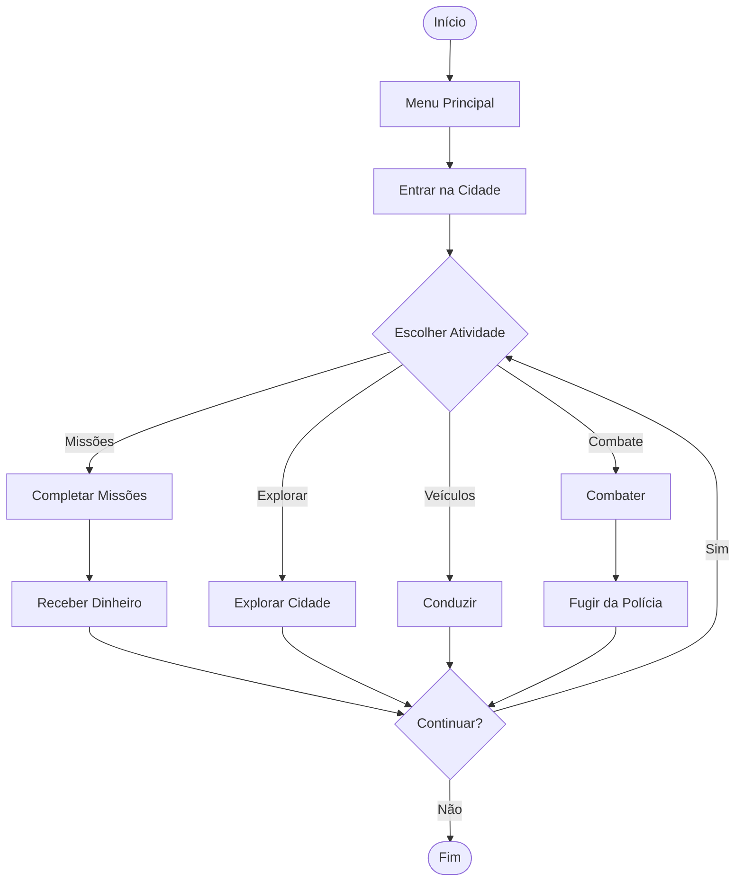

# 171

## Documentação do Jogo

 **171 é um jogo de ação em mundo aberto, ambientado numa cidade brasileira. O jogador pode explorar a cidade, conduzir veículos e realizar diferentes atividades**.  

## 1. Requisitos do Jogo

- **Número máximo de jogadores:** 1 jogador (nesta versão fictícia).
- **Plataforma:** PC (Windows).
- **Idade mínima recomendada:** 18 anos.
- **Género:** Ação e mundo aberto.

## 2. Imagem do Jogo

## 3. Link do Jogo

[Visitar a página do jogo 171](https://betagamesgroup.com/)

# Fluxograma do Jogo 171

## Gameplay

## 5. Conclusão

O fluxograma apresenta as diferentes escolhas do jogador. Cada decisão leva a um acontecimento e, no final, o jogo termina.
